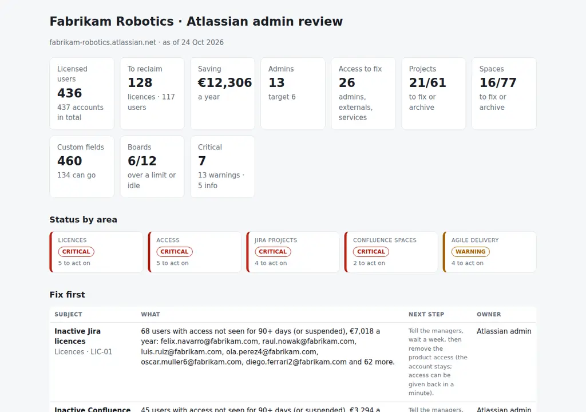

# Jira & Confluence Admin Kit

The monthly admin review of a Jira, Jira Service Management and Confluence Cloud site, built from the site's own exports: licences to reclaim (inactive, never used, suspended) with the saving and the seats against what you bought, the admins who should not be admins, external users and service accounts without an owner, Jira projects and Confluence spaces to fix or archive, custom fields and one-off schemes to clean up, and the agile health of every Scrum board (open sprints, carry-over, scope added, say/do, idle boards). Six CSVs, one JSON with the rules, one Python command, and the agenda for the review: **what to remove, what to fix, and who decides.**

Python 3.10+, standard library only. Runs with fictional demo data out of the box; a read-only PowerShell exporter for the Jira, Agile and Confluence Cloud REST APIs is included, and the user export from admin.atlassian.com loads as it is.



## Why

An Atlassian site grows by itself. Everybody who joins gets Jira through a default group, whether they will use it or not. Contractors keep access after the project ends. Somebody added a colleague to `jira-admins` "for a day" two years ago. A demo project still has Browse Projects open to Anyone. There are 460 custom fields, a third of them unused, and every one slows down the issue screens. Five projects have their own permission scheme that nobody reviews. And two Scrum boards have carried over a third of every sprint for months, which nobody notices because the board still looks busy.

None of this is hard to fix; it is hard to see. The licence bill, the security review and the retrospective all need the same thing: a list, with the rule that put each item on it, and a column for the decision. This tool produces those lists from the exports, with the rules in `settings.json` and `jcadmin/checks.py`.

## What it checks

| Area | Code | Finding |
|---|---|---|
| Licences | LIC-01 | Product access not used for `inactive_days`, or kept by suspended/deactivated accounts, with the cost per year |
| Licences | LIC-02 | Access never used `never_used_days` after the user was added (usually a default group) |
| Licences | LIC-03 | More users with access than seats licensed; or seats to drop at the renewal |
| Access | ACC-01 | More admins than `max_admins` |
| Access | ACC-02 | Admins who are deactivated or not seen for `inactive_days` |
| Access | ACC-03 | Admins on an unmanaged (external or personal) domain |
| Access | ACC-04 | External users with product access, by domain |
| Access | ACC-05 | Service and integration accounts without a named owner |
| Jira projects | JIR-01 | Browse Projects granted to Anyone |
| Jira projects | JIR-02 | No project lead, or a lead who has left |
| Jira projects | JIR-03 | No issue updated for `project_stale_days`: archive |
| Jira projects | JIR-04 | Permission and workflow schemes used by fewer than `shared_scheme_min` projects |
| Jira projects | JIR-05 | Custom fields over the budget, unused, with many contexts or global but barely used |
| Confluence spaces | CON-01 | Anonymous access enabled |
| Confluence spaces | CON-02 | No active space admin |
| Confluence spaces | CON-03 | No update for `space_stale_days`: archive |
| Confluence spaces | CON-04 | Personal spaces of deactivated users |
| Agile delivery | AGL-01 | Active sprints past their end date |
| Agile delivery | AGL-02 | Carry-over above `carryover_max_pct` of the commitment |
| Agile delivery | AGL-03 | Scope added after the start above `scope_added_max_pct` |
| Agile delivery | AGL-04 | Say/do (completed ÷ committed) below `say_do_min_pct` |
| Agile delivery | AGL-05 | Scrum boards with no sprint for `board_idle_days` and nothing planned |

## Outputs

| File | What |
|---|---|
| `report.html` | Tiles, status by area, "Fix first", seats, access to fix, projects and spaces to fix or archive, agile health with say/do per sprint, all findings |
| `admin-review.md` | The agenda: summary, seats, decisions as a checklist with owners, items for information, agile health |
| `licences.csv` | Every licence to reclaim, with why, cost per year, and `manager_ok` / `removed` columns to work through |
| `seats.csv` | Per product: licensed, with access, to reclaim, after, saving |
| `access-review.csv` | Admins, external users and service accounts with their issues and a `decision` column |
| `projects.csv`, `spaces.csv`, `fields.csv` | Every project, space and custom field with a verdict (ok, tidy, fix, archive, remove, review) and the reason |
| `boards.csv` | Per Scrum board: velocity, say/do, carry-over, scope added, idle days, verdict |
| `actions.csv`, `findings.csv` | The findings with owner and next step, ready for a tracker |

## Try it

```bash
git clone https://github.com/inigogonzalezgarcia/30-jira-confluence-admin-kit.git
cd 30-jira-confluence-admin-kit
python -m jcadmin demo
```

Open `output/report.html` and `output/admin-review.md`.

### The demo data

The demo is a made-up warehouse-robotics company, Fabrikam Robotics, on Jira, Jira Service Management and Confluence Cloud: 437 user accounts plus app and portal-customer accounts, 61 active Jira projects, 77 Confluence spaces, 460 custom fields and 12 Scrum boards, reviewed on 24 October 2026. Names, domains, seats and prices are invented.

The problems are placed on purpose:

- **Licences:** 128 licences to reclaim from 117 users (68 inactive in Jira, 45 in Confluence, 3 Jira Service Management agents, and 12 Sales users who got Jira through a default group and never opened it), about €12,300 a year; Jira over its 400 seats; Confluence with seats to drop at renewal.
- **Access:** 13 admins against a target of 6, including a deactivated site admin, a Jira admin not seen for five months and a contractor admin on a personal Gmail account; 20 users from two partner domains; three integration accounts without an owner, one of them in `jira-admins`.
- **Jira:** two projects open to Anyone, four with no lead or a lead who has left, projects idle for months, nine one-off schemes, and 134 custom fields that can go.
- **Confluence:** two spaces with anonymous access, four without an active admin, spaces untouched for years and personal spaces of leavers.
- **Agile:** one board with a sprint still open nine days after its end, two carrying over more than a third of every sprint (one of them finishing only 56% of what it commits), one with 28% of scope added mid-sprint, and two boards idle for months.

## Use it with your own site

1. Export the users from admin.atlassian.com (Directory → Users → Export users, with last-seen dates) to `data/users.csv`.
2. Export the rest with the read-only script:
   ```powershell
   .\scripts\Export-AtlassianSite.ps1 -Site https://your-site.atlassian.net -OutputFolder .\data
   ```
   - It only sends GET requests and asks for your e-mail and an API token; nothing is stored.
   - Sprint estimates come from the data behind Jira's Sprint Report, which is not a documented API; if it fails, the dates are still exported.
   - The REST API does not give the number of issues with a value per custom field; the tool then relies on the last-used date.
3. Write `data/settings.json`: seats and prices from your contract, managed domains, admin groups, service-account owners and the thresholds ([docs/data-format.md](docs/data-format.md)).
4. Build the outputs:
   ```bash
   python -m jcadmin review data/ --title "Atlassian admin review · November" --as-of 2026-11-02
   ```

[docs/admin-review-runbook.md](docs/admin-review-runbook.md) has the 45-minute agenda, how to read the agile numbers and what to do after the meeting.

The exports name people and their activity. Keep them inside your organisation:

- real files at the top level (`users*.csv`, `group_members*.csv`, `projects*.csv`, `spaces*.csv`, `sprints*.csv`, `custom_fields*.csv`, `settings.json`, `data/`) and the `output/` folder are excluded from Git by `.gitignore`;
- only the fictional files in `sample_data/` are committed;
- the exporter reads configuration, counts and dates; it never reads issue or page content.

## Tests

```bash
pip install -r requirements-dev.txt
python -m pytest -q
```

17 tests: the admin.atlassian.com export columns and value parsing, settings, licence verdicts (inactive, never used with a grace period for joiners, suspended, app and customer accounts), seats and saving, admin, external and service-account checks (a surname is not a service account), project and space verdicts, custom fields including unknown usage, the agile metrics and limits over the last sprints only, findings ordering, and the demo end to end (deterministic, all eleven outputs).

## Next steps

- Read users from the organisation's user API when an admin API key is available, instead of the CSV export.
- Kanban boards: WIP limits exceeded and the age of items in each column.
- A month-on-month view, so the review opens with what changed since last time.
- Jira Service Management: queues without an owner and SLA goals nobody watches.

## Background

Built from my work administering Jira and Confluence, including:

- site and product administration of Jira and Confluence and the relationship with Atlassian;
- Agile/Scrum delivery, acting as Scrum Master and Product Owner, Kanban and visual management, and portfolio views across initiatives;
- release management (planning, testing, rollback, post-release validation) and changes taken through the CAB;
- licence and vendor management, where reclaiming unused seats before a renewal is part of the job.

Written from scratch with fictional data; no employer data, sites or exports are used.

## Customisation and contact

Want this adapted to your site? For example:

- your licence model (Premium, Enterprise, multiple sites) and your contract prices;
- your own rules for admins, partners and service accounts;
- Kanban metrics, Jira Service Management queues or Confluence permissions in more depth;
- the review written into your Confluence as a page each month.

Get in touch:

- Website (contact form): [inigogonzalezgarcia.github.io](https://inigogonzalezgarcia.github.io/about.html#contacto)
- LinkedIn: [linkedin.com/in/igonzalez93](https://www.linkedin.com/in/igonzalez93)

## License

MIT
